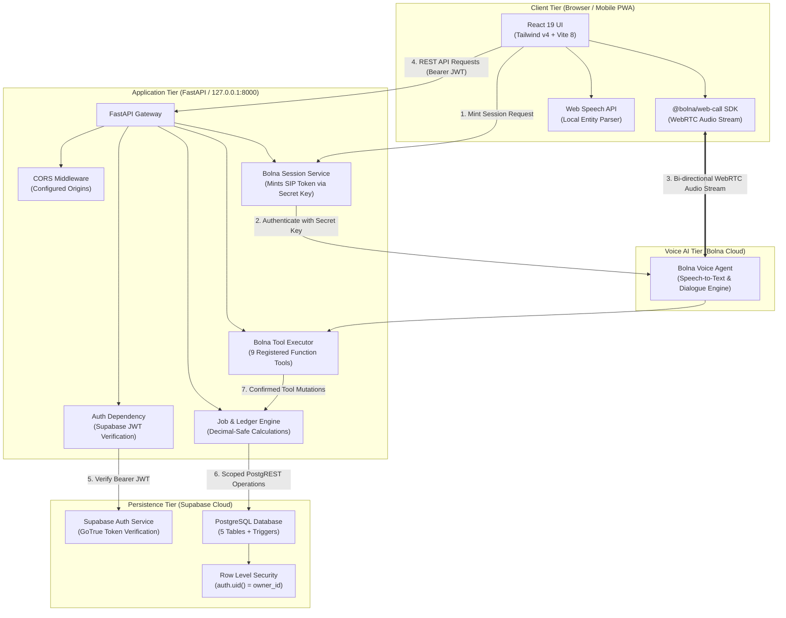

# KaamSaathi (काम साथी / কাজ সাথী)

> **Voice-First Workday Assistant & Financial Ledger for Independent Technicians**

KaamSaathi is a mobile-responsive web platform engineered for solo field technicians—electricians, plumbers, and appliance mechanics across India. It addresses the daily operational hurdles of lost earnings, paper diary discrepancies, and forgotten customer follow-ups through bilingual voice logging, automated payment reconciliation, customer debt ("udhaar") tracking, and deterministic balance calculations.

---

## Table of Contents

1. [Overview](#overview)
2. [Core Features & Status](#core-features--status)
3. [System Architecture](#system-architecture)
4. [Technology Stack](#technology-stack)
5. [Repository Structure](#repository-structure)
6. [Prerequisites](#prerequisites)
7. [Installation & Local Setup](#installation--local-setup)
8. [Environment Configuration](#environment-configuration)
9. [Database Setup & Migrations](#database-setup--migrations)
10. [API Reference](#api-reference)
11. [Testing & Quality Assurance](#testing--quality-assurance)
12. [Security Architecture](#security-architecture)
13. [Known Limitations](#known-limitations)
14. [MVP Roadmap](#mvp-roadmap)
15. [Contributing & License](#contributing--license)
16. [Acknowledgements](#acknowledgements)

---

## Overview

### The Problem
Independent field technicians in India operate under high-friction conditions. They juggle toolkits, negotiate repair charges on site, receive mixed cash and UPI payments, and frequently extend short-term credit ("udhaar") to customers. Technicians traditionally record these transactions in paper notebooks or keep mental tallies. This leads to:
- **Unrecovered debt ("udhaar")**: Technicians forget who owes them money and how much.
- **Lost service history**: No accessible record of previous repair work or customer promises.
- **Missed follow-ups**: Appliance warranties and scheduled return visits are forgotten.
- **High digital friction**: Existing accounting apps require extensive manual keyboard entry, which is impractical with dusty or occupied hands.

### The Voice-First Solution
KaamSaathi provides a voice-first workflow powered by Bolna AI and WebRTC audio streaming, with local speech heuristics as a fallback. A technician can speak naturally in English, Hindi, or Bengali (e.g., *"Suman Ghosh ceiling fan repair 1200 rupees, 500 paid"*). The system:
1. Transcribes and extracts structured entities (customer name, trade, repair description, agreed fee, advance payment).
2. Performs a verbal and visual readback of the draft.
3. Requires explicit confirmation (`confirmed: true`) before committing any financial or job record to the database.
4. Deterministically tracks remaining debt and aggregates collections on the technician's dashboard.

### Intended Users & MVP Scope
The primary audience consists of solo, independent trade technicians in India (electricians, plumbers, appliance mechanics). The MVP scope is strictly focused on:
- Single-operator job logging and status tracking.
- Incremental cash and UPI payment recording.
- Deterministic calculation of outstanding balances.
- Date-driven customer follow-up reminders.
- Natural-language Q&A over the technician's saved records.
- Honest, real-time dashboard metrics (no fabricated demo records).

---

## Core Features & Status

| Feature | Description | Implementation Status | Evidence in Codebase |
|---|---|---|---|
| **Voice Interaction via Bolna** | Real-time WebRTC audio streaming to Bolna AI with server-side session minting and function calling. | **Implemented & Verified** | `@bolna/web-call` in [`frontend/src/services/bolnaVoiceService.ts`](frontend/src/services/bolnaVoiceService.ts), [`backend/app/routes/bolna.py`](backend/app/routes/bolna.py) |
| **Job Creation & Retrieval** | Structured job logging with trade categorisation, status filters, search queries, and verbal confirmation gates. | **Implemented & Verified** | [`backend/app/routes/jobs.py`](backend/app/routes/jobs.py), [`frontend/src/components/JobsView.tsx`](frontend/src/components/JobsView.tsx) |
| **Payment Recording & Reconciliation** | Incremental payment tracking (Cash, UPI, Bank Transfer) with mathematical balance recalculation and overpayment rejection. | **Implemented & Verified** | [`backend/app/routes/payments.py`](backend/app/routes/payments.py), [`supabase/migrations/003_create_payment_events_table.sql`](supabase/migrations/003_create_payment_events_table.sql) |
| **Customer Follow-Up Reminders** | Scheduling, priority tagging (`normal`, `urgent`), date filtering, and 1-tap completion toggles. | **Implemented & Verified** | [`backend/app/routes/reminders.py`](backend/app/routes/reminders.py), [`frontend/src/components/RemindersView.tsx`](frontend/src/components/RemindersView.tsx) |
| **Ledger Q&A from Saved Records** | Natural language queries (e.g., *"Who owes me money?"*, *"How much did Ramesh pay?"*) answered directly from PostgreSQL records. | **Implemented & Verified** | `answer_ledger_question` in [`backend/app/services/bolna_tools.py`](backend/app/services/bolna_tools.py), [`backend/tests/test_bolna_workflows.py`](backend/tests/test_bolna_workflows.py) |
| **Live Dashboard Metrics** | Real-time aggregates of total jobs, collected revenue, outstanding debt, and upcoming follow-ups without mock data. | **Implemented & Verified** | [`backend/app/routes/dashboard.py`](backend/app/routes/dashboard.py), [`frontend/src/components/DashboardView.tsx`](frontend/src/components/DashboardView.tsx) |
| **Bilingual Localization** | Full UI language toggle between English and Bengali (বাংলা). | **Implemented & Verified** | [`frontend/src/locales/translations.ts`](frontend/src/locales/translations.ts), [`frontend/src/components/Navbar.tsx`](frontend/src/components/Navbar.tsx) |
| **End-User Phone/OTP Auth Screen** | Dedicated mobile OTP / WhatsApp login interface on the frontend. | **Planned** | Backend derives identity via JWT; client currently uses bearer session header. |
| **Offline Background Sync Queue** | Local SQLite / IndexedDB sync engine for queuing writes while completely offline. | **Planned** | Frontend provides honest offline warnings; offline storage fallback operates in read-only empty state. |

---

## System Architecture

KaamSaathi is organized into four distinct tiers:
1. **Client Tier (React 19 + Vite 8 + Tailwind CSS v4)**: Mobile-optimized interface with warm ivory canvas (`#fbfbf9`), charcoal typography (`#1c1917`), emerald status accents (`#15803d`), and 44px minimum touch targets. Renders views, visualizes metrics, and handles audio streaming via `@bolna/web-call`.
2. **Application Tier (FastAPI + Python 3.11)**: REST gateway responsible for JWT verification, input validation, decimal-safe arithmetic, Bolna tool execution, and session minting.
3. **Voice AI Tier (Bolna Cloud)**: Speech processing and conversation orchestration, executing function calls through registered tool schemas.
4. **Data Tier (Supabase PostgreSQL 15+)**: Relational storage enforcing Row Level Security (RLS) on all tables (`customers`, `jobs`, `payment_events`, `reminders`, `audit_events`).

### Architecture & Request Flow Diagram



---

## Technology Stack

### Frontend
- **Framework**: React 19.0.1
- **Runtime & Build**: Vite 8.3.0
- **Language**: TypeScript 7.0.2
- **Styling**: Tailwind CSS v4.3.3 (`@tailwindcss/vite`)
- **Voice SDK**: `@bolna/web-call` v3.0.1
- **Icons & Motion**: Lucide React v0.546.0, Motion v12.23.24
- **Data Visualization**: Recharts v3.10.1

### Backend
- **Framework**: FastAPI v0.110.0+
- **ASGI Server**: Uvicorn v0.28.0+
- **Language**: Python 3.11.x
- **Validation**: Pydantic v2.6.0+, Pydantic Settings v2.2.0+
- **Database Client**: Supabase Python Client v2.4.0+
- **HTTP Client**: HTTPX v0.27.0+
- **Testing**: Pytest v8.1.0+, Pytest-asyncio v0.23.0+

### Database & Cloud
- **Database**: PostgreSQL 15+ hosted on Supabase
- **Security**: PostgreSQL Row Level Security (RLS) & `pgcrypto`
- **Voice Platform**: Bolna AI Web Call API (`api.bolna.ai`)

---

## Repository Structure

```
KaamSaathi/
├── frontend/                     # React 19 + TypeScript + Tailwind CSS application
│   ├── public/                   # Static assets (favicons, manifest)
│   ├── src/                      # Application source code
│   │   ├── assets/               # Media, logos, and graphics
│   │   ├── components/           # UI components, modals, views, and navigation
│   │   │   ├── DashboardView.tsx     # Real-time metrics and quick ledger overview
│   │   │   ├── JobsView.tsx          # Searchable, filtered jobs list
│   │   │   ├── PaymentsView.tsx      # Debtors list and payment history
│   │   │   ├── RemindersView.tsx     # Follow-up schedule with check-off action
│   │   │   ├── VoiceAssistantModal.tsx # 6-state voice assistant modal
│   │   │   ├── JobModal.tsx          # Confirmed job creation and edit form
│   │   │   ├── RecordPaymentModal.tsx # Incremental payment collection form
│   │   │   ├── ReminderModal.tsx     # Follow-up scheduling form
│   │   │   ├── Navbar.tsx            # Header with language toggle and auth status
│   │   │   └── MobileBottomNav.tsx   # Thumb-accessible navigation bar
│   │   ├── hooks/                # Custom React hooks (audio recording)
│   │   ├── locales/              # Translation dictionaries (English, Bengali)
│   │   ├── services/             # API clients (jobApi, bolnaVoiceService, storage)
│   │   ├── types/                # TypeScript interfaces and domain types
│   │   ├── utils/                # Currency (INR) and date formatting helpers
│   │   ├── App.tsx               # Root application component and state coordinator
│   │   ├── main.tsx              # React DOM entrypoint
│   │   └── index.css             # Tailwind v4 configuration and global tokens
│   ├── index.html                # Single-page application root HTML
│   ├── package.json              # Frontend dependencies and scripts
│   ├── tsconfig.json             # TypeScript compiler settings
│   ├── vite.config.ts            # Vite bundler configuration
│   ├── .env.example              # Frontend environment template
│   └── README.md                 # Frontend developer guide
├── backend/                      # FastAPI Python backend
│   ├── app/                      # Application package
│   │   ├── main.py               # Application entrypoint, CORS, route registration
│   │   ├── config.py             # Pydantic BaseSettings and environment flags
│   │   ├── database.py           # Supabase client singleton & auth dependencies
│   │   ├── dependencies/         # Scoped database client and JWT user resolvers
│   │   ├── routes/               # Modular REST endpoints
│   │   │   ├── jobs.py               # Job CRUD, search, and job payment listing
│   │   │   ├── payments.py           # Global payment feed and payment corrections
│   │   │   ├── reminders.py          # Reminder lifecycle and completion toggle
│   │   │   ├── dashboard.py          # Deterministic KPI calculations
│   │   │   └── bolna.py              # Bolna session proxy and tool execution
│   │   ├── schemas/              # Pydantic v2 validation models
│   │   └── services/             # Core business logic and reconciliation engines
│   │       ├── jobs.py               # Job, payment, and dashboard calculations
│   │       ├── reminders.py          # Reminder lifecycle operations
│   │       └── bolna_tools.py        # 9 Bolna function contracts & execution handler
│   ├── tests/                    # Automated Pytest suite (53 test assertions)
│   ├── requirements.txt          # Python dependencies
│   ├── pytest.ini                # Pytest configuration and pythonpath
│   ├── .env.example              # Backend environment template
│   └── README.md                 # Backend developer guide
├── supabase/                     # Database migrations
│   └── migrations/               # Authoritative SQL migrations
│       ├── 000_full_schema.sql       # Consolidated idempotent migration script
│       ├── 001_create_jobs_table.sql
│       ├── 002_create_customers_table.sql
│       ├── 003_create_payment_events_table.sql
│       ├── 004_create_reminders_table.sql
│       └── 005_create_audit_events_table.sql
├── docs/                         # Engineering specifications and logs
│   ├── ARCHITECTURE.md           # System topology and component breakdown
│   ├── DATABASE_SCHEMA.md        # PostgreSQL schema, constraints, and RLS policies
│   ├── API_SPEC.md               # REST API documentation
│   ├── TEST_PLAN.md              # QA test matrix and verification criteria
│   ├── ENVIRONMENT_SETUP.md      # Local setup and configuration manual
│   ├── DEVELOPMENT_LOG.md        # Chronological audit log of all changes
│   ├── DECISIONS.md              # Architecture Decision Records (ADRs)
│   ├── PROJECT_PLAN.md           # Project scope and milestone plan
│   └── ROADMAP.md                # Project roadmap
├── AGENTS.md                     # Engineering rules and operational governance
├── PROJECT_STATUS.md             # Real-time component health tracking
├── .gitignore                    # Git exclusions
├── .env.example                  # Root environment template
└── README.md                     # This document
```

---

## Prerequisites

Before starting local development on Windows, ensure the following are installed:
- **Node.js**: v18.0.0 or higher (v20+ or v24+ recommended; tested on v24.21.0)
- **npm**: v9.0.0 or higher
- **Python**: 3.11.x (verified on Python 3.11.9 64-bit; must be available on Windows PATH)
- **PowerShell**: Windows PowerShell 5.1 or PowerShell 7+
- **Supabase Account**: A Supabase cloud project for PostgreSQL and Auth
- *(Optional)* **Bolna AI Account**: A Bolna agent ID and API key for live voice calls

---

## Installation & Local Setup

Execute the following PowerShell commands from the repository root:

### 1. Frontend Setup

Open a PowerShell terminal:

```powershell
# Navigate to the frontend directory
cd frontend

# Install Node.js dependencies
npm install

# Create local environment file from template
Copy-Item .env.example .env

# Start the Vite development server (accessible at http://localhost:3000)
npm run dev
```

### 2. Backend Setup

Open a second PowerShell terminal:

```powershell
# Navigate to the backend directory
cd backend

# Create a Python virtual environment
python -m venv venv

# Activate the virtual environment
.\venv\Scripts\Activate.ps1

# Upgrade pip and install dependencies
python -m pip install --upgrade pip
pip install -r requirements.txt

# Create local environment file from template
Copy-Item .env.example .env

# Start the FastAPI server (accessible at http://127.0.0.1:8000)
uvicorn app.main:app --reload --host 127.0.0.1 --port 8000
```

> **Note on PowerShell Script Execution**: If activating the virtual environment produces `running scripts is disabled on this system`, run:
> ```powershell
> Set-ExecutionPolicy -Scope Process -ExecutionPolicy RemoteSigned
> .\venv\Scripts\Activate.ps1
> ```

---

## Environment Configuration

KaamSaathi enforces a strict separation between client-safe variables and backend secrets:

### Backend Variables (`backend/.env`)

These credentials stay strictly on the server and are never bundled into client code:

| Variable | Description | Example / Format |
|---|---|---|
| `SUPABASE_URL` | Supabase Project HTTPS URL (from Project Settings -> API) | `https://your-project.supabase.co` |
| `SUPABASE_KEY` | Supabase API key (anon or service role key used by backend) | `eyJhbGciOi...` |
| `BOLNA_API_KEY` | Private Bolna API authentication key | `bn-your-secret-api-key` |
| `BOLNA_AGENT_ID` | UUID of your configured Bolna Voice Agent | `00000000-0000-0000-0000-000000000000` |
| `ENVIRONMENT` | Runtime environment mode | `development` |
| `HOST` | Local binding interface | `127.0.0.1` |
| `PORT` | Local binding port | `8000` |
| `FRONTEND_ORIGINS` | Permitted CORS origins for local web development | `http://localhost:3000,http://127.0.0.1:3000` |

### Frontend Variables (`frontend/.env`)

Only variables prefixed with `VITE_` are exposed to the client bundle:

| Variable | Description | Default / Example |
|---|---|---|
| `VITE_API_BASE_URL` | Base URL of the backend REST gateway | `http://127.0.0.1:8000` |
| `VITE_BOLNA_SESSION_URL` | Backend proxy URL for minting WebRTC sessions | `http://127.0.0.1:8000/api/bolna-session` |

---

## Database Setup & Migrations

KaamSaathi uses Supabase PostgreSQL with Row Level Security (RLS). All migrations are idempotent (`CREATE TABLE IF NOT EXISTS`, `CREATE INDEX IF NOT EXISTS`, `DROP TRIGGER IF EXISTS`, `DROP POLICY IF EXISTS`), allowing safe execution without dropping existing data.

### Option A: Consolidated Execution (Recommended)
1. Open the [Supabase Dashboard](https://supabase.com/dashboard) and select your project.
2. Navigate to **SQL Editor**.
3. Open [`supabase/migrations/000_full_schema.sql`](supabase/migrations/000_full_schema.sql), copy its complete contents, paste into the editor, and click **Run**.

### Option B: Step-by-Step Execution
Run each migration script in sequential order:
1. [`supabase/migrations/001_create_jobs_table.sql`](supabase/migrations/001_create_jobs_table.sql): Creates `public.jobs` with check constraints and RLS.
2. [`supabase/migrations/002_create_customers_table.sql`](supabase/migrations/002_create_customers_table.sql): Creates `public.customers` with unique phone per owner.
3. [`supabase/migrations/003_create_payment_events_table.sql`](supabase/migrations/003_create_payment_events_table.sql): Creates `public.payment_events` and automatic balance reconciliation trigger.
4. [`supabase/migrations/004_create_reminders_table.sql`](supabase/migrations/004_create_reminders_table.sql): Creates `public.reminders` for customer follow-ups.
5. [`supabase/migrations/005_create_audit_events_table.sql`](supabase/migrations/005_create_audit_events_table.sql): Creates `public.audit_events` for security auditing.

### Database Tables & Security Policies

| Table | Primary Columns | Constraints & Invariants | RLS Policy |
|---|---|---|---|
| `customers` | `id`, `owner_id`, `name`, `phone`, `address`, `notes` | `UNIQUE(owner_id, phone)`, valid phone & name lengths. | Authenticated users can only CRUD rows where `auth.uid() = owner_id`. |
| `jobs` | `id`, `owner_id`, `customer_id`, `customer_name`, `trade`, `agreed_amount`, `amount_paid`, `remaining_balance`, `status` | `agreed_amount > 0`, `amount_paid >= 0`, `amount_paid <= agreed_amount`. `remaining_balance` is a generated column (`agreed_amount - amount_paid`). | Authenticated users can only CRUD rows where `auth.uid() = owner_id`. |
| `payment_events` | `id`, `owner_id`, `job_id`, `amount`, `payment_mode`, `recorded_at` | `amount > 0`, `payment_mode IN ('cash', 'upi', 'bank_transfer')`. Foreign key to `jobs(id)` ON DELETE CASCADE. | Authenticated users can only CRUD rows where `auth.uid() = owner_id`. |
| `reminders` | `id`, `owner_id`, `job_id`, `task`, `due_date`, `is_completed`, `priority` | `due_date` DATE format, `priority IN ('normal', 'urgent')`. | Authenticated users can only CRUD rows where `auth.uid() = owner_id`. |
| `audit_events` | `id`, `owner_id`, `action`, `entity_type`, `entity_id`, `payload` | Immutable audit log capturing financial mutations and corrections. | Authenticated users can only read and insert rows where `auth.uid() = owner_id`. |

---

## API Reference

Interactive API documentation is generated by FastAPI and available at:
- **Swagger UI**: [http://127.0.0.1:8000/docs](http://127.0.0.1:8000/docs)
- **ReDoc**: [http://127.0.0.1:8000/redoc](http://127.0.0.1:8000/redoc)

### Authentication
All `/api/*` endpoints (except health and session minting) require an HTTP Authorization header:
```http
Authorization: Bearer <supabase_access_token>
```
If the token is missing or invalid, the API returns `401 Unauthorized`. If Supabase is unconfigured, it returns `503 Service Unavailable`.

### Endpoints Overview

#### 1. System Endpoints
- `GET /`: Returns API root status and documentation links.
- `GET /health` and `GET /api/health`: Returns service health (`status: "healthy"`) and database connectivity status (`database_configured: true|false`) without exposing credentials.

#### 2. Jobs Endpoints
- `POST /api/jobs`: Creates a confirmed job assignment.
  - **Payload**: `customer_name`, `description`, `trade`, `agreed_amount` (> 0), `amount_paid` (>= 0), `confirmed` (**must be `true`**).
  - **Status**: `201 Created`
- `GET /api/jobs`: Lists authorized jobs for the authenticated technician.
  - **Query Params**: `q` (search string), `status` (`pending`, `in_progress`, `partially_paid`, `completed`).
  - **Status**: `200 OK`
- `GET /api/jobs/{job_id}`: Retrieves single job. Returns `404 Not Found` if missing or belonging to another user.
- `PUT /api/jobs/{job_id}`: Updates job details. If financial fields or status are modified, `confirmed: true` is strictly required.
- `DELETE /api/jobs/{job_id}`: Deletes job and cascades to related payment events.

#### 3. Payments Endpoints
- `POST /api/jobs/{job_id}/payments`: Records an incremental payment event.
  - **Payload**: `amount` (> 0), `payment_mode` (`cash`, `upi`, `bank_transfer`), `notes`, `confirmed` (**must be `true`**).
  - **Validation**: Rejects payments exceeding remaining unpaid balance (`400 Bad Request`).
  - **Status**: `201 Created`
- `GET /api/jobs/{job_id}/payments`: Lists payment transactions recorded for a specific job.
- `GET /api/payments`: Lists all payment transactions across all jobs for the authenticated technician.
- `POST /api/payments/{payment_id}/correct`: Submits an audited payment correction. Updates remaining balance deterministically.

#### 4. Reminders Endpoints
- `POST /api/reminders`: Schedules a follow-up reminder.
  - **Payload**: `task`, `due_date` (`YYYY-MM-DD`), `priority` (`normal`, `urgent`), optional `job_id`, optional `trade`.
  - **Status**: `201 Created`
- `GET /api/reminders`: Lists reminders. Query param `include_completed=true|false`.
- `PATCH /api/reminders/{reminder_id}/toggle`: Toggles reminder completion state.
- `DELETE /api/reminders/{reminder_id}`: Cancels and removes a reminder.

#### 5. Dashboard Endpoints
- `GET /api/dashboard/stats`: Returns aggregated financial metrics:
  ```json
  {
    "total_jobs": 12,
    "total_agreed": 18500.0,
    "total_collected": 14200.0,
    "total_outstanding": 4300.0,
    "pending_jobs_count": 4,
    "completed_jobs_count": 8,
    "upcoming_reminders_count": 3,
    "weekly_earnings": [
      { "date": "2026-10-15", "day": "Thu", "amount": 2400.0, "jobs_count": 2 }
    ]
  }
  ```

#### 6. Voice Assistant & Bolna Integration Endpoints
- `GET /api/bolna/tools`: Returns 9 registered function contracts in OpenAI tool format or Bolna Custom Task format.
- `POST /api/bolna-session`: Mints a short-lived WebRTC session token via Bolna Cloud using `BOLNA_API_KEY`.
- `POST /api/bolna/tools/execute`: Gateway for function calling execution (`create_job`, `list_jobs`, `record_payment`, `get_outstanding_balances`, `create_reminder`, `list_reminders`, `complete_reminder`, `correct_record`, `answer_ledger_question`). Enforces explicit confirmation for financial writes.

---

## Testing & Quality Assurance

KaamSaathi includes an automated test harness covering financial calculations, security boundaries, authentication isolation, and end-to-end workflows.

### Run Automated Tests

#### Backend Test Suite (Pytest)
From the repository root (or inside `backend/` with active virtual environment):

```powershell
backend\venv\Scripts\pytest backend/tests -v
```

**Verified Test Status**:
- **53 passed** out of 53 test cases (executed in ~4.1 seconds).
- Coverage includes:
  - Unauthenticated access rejection (`HTTP 401`).
  - Strict confirmation gates (`confirmed: true` enforcement).
  - Prevention of overpayments and non-positive numbers.
  - Cross-user tenant isolation (user A cannot access user B's records).
  - All 9 Bolna tool contracts and execution handlers.
  - Deterministic ledger Q&A against saved records.
  - End-to-end workflows A, B, C, and D.

#### Frontend Type Safety Check
From `frontend/` directory:

```powershell
npm run lint
```
**Verified Status**: `tsc --noEmit` exits with **0 errors**.

#### Frontend Production Build Check
From `frontend/` directory:

```powershell
npm run build
```
**Verified Status**: Production bundle compiles cleanly via Vite in **~280ms**.

---

## Security Architecture

1. **Strict Identity Derivation**: The backend never accepts `owner_id` or user IDs from request bodies or query parameters. Identity is derived server-side exclusively from the verified Supabase Bearer JWT token (`supabase.auth.get_user(token)`).
2. **Database Row Level Security (RLS)**: Every table has RLS enabled with explicit `auth.uid() = owner_id` checks for `SELECT`, `INSERT`, `UPDATE`, and `DELETE`.
3. **Secret Isolation**: Secret keys (`BOLNA_API_KEY`, Supabase private keys) exist only in `backend/.env`. All `.env` files are excluded by [`.gitignore`](.gitignore). Frontend code accesses voice sessions through a backend proxy without exposing credentials.
4. **Deterministic Financial Validation**: Monetary values are validated using Pydantic `Decimal`. Zero or negative job charges are rejected (`HTTP 422`), and payments exceeding the agreed balance are blocked (`HTTP 400`).
5. **Mandatory Confirmation Gates**: Mutations to financial state (job creation, payment recording, balance adjustments) require `confirmed: true`. Speech recognition drafts cannot be committed without explicit technician confirmation.

---

## Known Limitations

- **Frontend Auth Interface**: End-user registration and login UI (e.g., Phone OTP or WhatsApp OTP screen) is planned for the next phase. Currently, authentication during local development uses a bearer token header.
- **Web Speech API Browser Compatibility**: The fallback speech parser utilizes the browser's Web Speech API. While fully supported in Chromium-based browsers, browsers without Web Speech support (such as Firefox on desktop) rely on the live Bolna WebRTC audio stream or manual input forms.
- **Offline Sync Queue**: The application handles offline states gracefully with clear warnings and honest empty lists. However, a persistent offline-first write queue (storing actions in IndexedDB and syncing upon reconnect) is not yet implemented.

---

## MVP Roadmap

The remaining tasks to complete the original KaamSaathi MVP scope are:
1. **Production Database Migration**: Run [`supabase/migrations/000_full_schema.sql`](supabase/migrations/000_full_schema.sql) in the user's production Supabase project.
2. **Production Bolna Agent Configuration**: Link production `BOLNA_AGENT_ID` and `BOLNA_API_KEY` with bilingual system prompt configuration.
3. **Frontend Authentication Screen**: Implement mobile phone OTP login view integrated with Supabase GoTrue Auth.
4. **Production Deployment**: Containerize FastAPI backend for container hosting and configure production frontend hosting with custom domain.

---

## Contributing & License

### Contributing
Contributions to KaamSaathi are subject to the governance rules defined in [`AGENTS.md`](AGENTS.md):
- **Inspect Before Modifying**: Verify directory contents and existing test suites before authoring changes.
- **Financial Invariants**: Never bypass decimal validation or confirmation gates.
- **Mandatory Quality Gates**: Every code modification must pass `npm run lint`, `npm run build`, and `pytest backend/tests/ -v`.
- **Zero Secret Commits**: Never commit actual API keys, database URLs with passwords, or `.env` files.

### License
This repository does not currently include an open-source license. All rights are reserved by the repository owner (`ankitpal32`). Commercial use, redistribution, or modification without explicit permission is prohibited.

---

## Acknowledgements

- [FastAPI](https://fastapi.tiangolo.com/) — High-performance Python web framework
- [React](https://react.dev/) — User interface library
- [Vite](https://vitejs.dev/) — Frontend build tooling
- [Tailwind CSS](https://tailwindcss.com/) — Utility-first CSS framework
- [Supabase](https://supabase.com/) — Open-source Firebase alternative with PostgreSQL and RLS
- [Bolna AI](https://bolna.ai/) — Real-time conversational voice agent infrastructure
- [Lucide Icons](https://lucide.dev/) — Clean, accessible iconography
- [Recharts](https://recharts.org/) — Composable charting library
