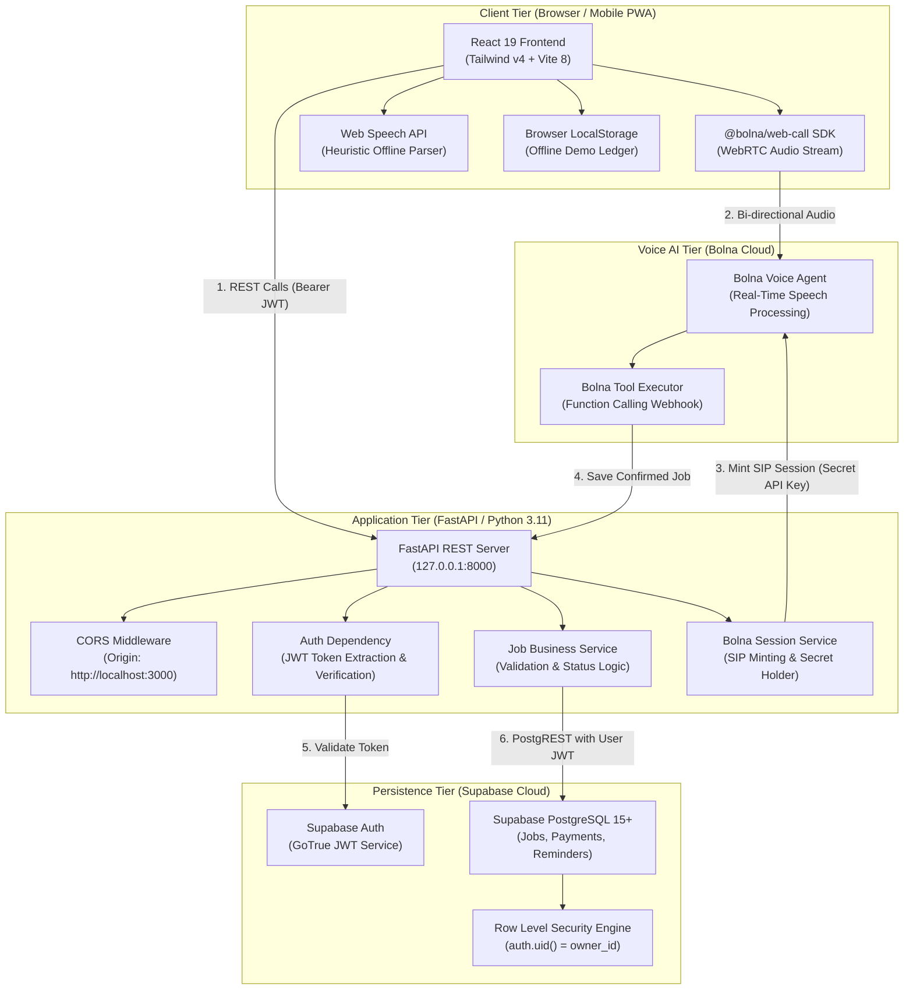

# KaamSaathi — System Architecture & Technical Design

> **Document Version**: 1.0.0  
> **Status**: Verified for Current Scaffolding & Blueprint for Full System  

---

## 1. Architectural Philosophy

KaamSaathi is built as a **voice-first, mobile-responsive, multi-tier web application**. It adheres to:
1. **Strict Client-Side Security**: No administrative, service-role, or AI secrets ever touch the browser bundle.
2. **Deterministic Financial Math**: Financial calculations (agreed amount, amount paid, unpaid balance) are computed deterministically, never estimated by generative AI.
3. **Graceful Offline Degradation**: The client remains interactive even when disconnected, using local demo storage and clear status indicators.
4. **Row-Level Tenant Isolation**: Technician data is partitioned at the PostgreSQL storage level via Supabase Row Level Security (RLS).

---

## 2. End-to-End System Architecture



---

## 3. Subsystem Breakdown

### 3.1 React Frontend (`frontend/`)
- **Technology**: React 19, TypeScript, Tailwind CSS v4, Vite 8.
- **Role**: Render responsive views, handle user input, visualize metrics with Recharts, maintain audio visualization, and toggle languages between English and Bengali.
- **Service Layer**:
  - `frontend/src/services/jobApi.ts`: Interacts with FastAPI backend using configurable `VITE_API_BASE_URL`.
  - `frontend/src/services/bolna.ts`: Encapsulates `@bolna/web-call` SDK event listeners.
  - `frontend/src/services/voiceParser.ts`: Local regex-based fallback for speech entity parsing.
  - `frontend/src/services/storage.ts`: Browser `localStorage` cache and demo data repository.

### 3.2 FastAPI Backend (`backend/`)
- **Technology**: Python 3.11, FastAPI, Uvicorn, Pydantic v2.
- **Role**: Secure application gateway, credentials manager, input validator, and business logic engine.
- **Key Modules under `backend/app/`**:
  - `app/main.py`: Bootstrapping, CORS configuration, system routes (`/`, `/health`).
  - `app/config.py`: Environment-based settings via `pydantic-settings`.
  - `app/database.py`: Supabase client initialization and dependency re-exports.
  - `app/dependencies/auth.py`: Derives authenticated user identity from Supabase JWT.
  - `app/schemas/`: Pydantic request/response models with decimal-safe validation.
  - `app/routes/`: Modular endpoints (`jobs.py`, `payments.py`, `reminders.py`, `dashboard.py`, `bolna.py`).
  - `app/services/`: Core logic (`jobs.py`, `reminders.py`, `bolna_tools.py`).

### 3.3 Supabase PostgreSQL Database
- **Technology**: PostgreSQL 15+ with `pgcrypto` and `auth.users`.
- **Role**: Durable, ACID-compliant relational persistence with built-in user isolation.
- **Security Mechanism**:
  - Row Level Security (RLS) is enabled on all tables.
  - Policies enforce that `auth.uid() = owner_id` for `SELECT`, `INSERT`, `UPDATE`, and `DELETE`.
  - Triggers automatically synchronize `updated_at` timestamps on row updates.

### 3.4 Bolna Voice Integration
- **Technology**: Bolna Web Call SDK (`@bolna/web-call`) and WebRTC.
- **Role**: Conversational voice agent capable of understanding Indian accents, extracting structured fields, and triggering function calls.
- **Security Boundary**: The browser client never touches `BOLNA_API_KEY`. The frontend requests a short-lived session URL from the backend (`/api/bolna-session`), which mints the WebRTC session credentials.

---

## 4. Data Flow & Security Boundaries

```
[Browser Client]
       │
       │ (1) Sends Authorization: Bearer <jwt>
       ▼
[FastAPI Backend]
       │
       │ (2) Verifies JWT with Supabase Auth (derives owner_id)
       ▼
[Supabase Auth Service]
       │
       │ (3) Token confirmed valid for User UUID
       ▼
[FastAPI JobService]
       │
       │ (4) Enforces confirmed == True & valid monetary amounts
       │ (5) Sets owner_id = authenticated user UUID
       │ (6) Executes PostgREST query with User JWT
       ▼
[Supabase PostgreSQL]
       │
       │ (7) RLS Policy: auth.uid() == owner_id evaluated
       ▼
[Database Record Created]
```

### Security Guardrails
1. **No Client Trust**: The backend never accepts an `owner_id` provided in the request body. Ownership is derived exclusively from the verified Bearer token.
2. **Explicit Confirmation**: A job cannot be created without explicit user confirmation (`confirmed: true`), ensuring technicians do not save accidental speech drafts.
3. **Sanitized Logs**: Backend logs avoid printing sensitive customer phone numbers or full financial breakdowns.
