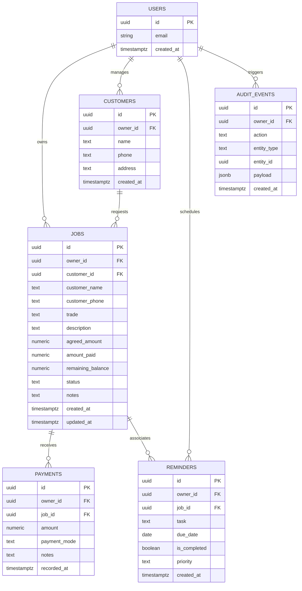

# KaamSaathi — Database Schema Specification

> **Target Engine**: PostgreSQL 15+ (Supabase)  
> **Security Model**: Row Level Security (RLS) with Authenticated Tenant Isolation  
> **Status**:  
> - `jobs` table: **Migration Prepared & Ready** (`supabase/migrations/001_create_jobs_table.sql`)  
> - `customers`, `payment_events`, `reminders`, `audit_events` tables: **Migrations Prepared & Ready** (`supabase/migrations/002_create_customers_table.sql` to `005_create_audit_events_table.sql`)

---

## 1. Entity Relationship Overview

---

## 2. Table Specifications

### 2.1 Table: `jobs` (Status: Prepared in Migration 001)

Stores individual service assignments, agreed charges, paid advances, and remaining balances.

| Column | Data Type | Constraints | Description |
|---|---|---|---|
| `id` | `UUID` | `PRIMARY KEY DEFAULT gen_random_uuid()` | Unique job identifier |
| `owner_id` | `UUID` | `NOT NULL REFERENCES auth.users(id) ON DELETE CASCADE` | Authenticated technician UUID |
| `customer_name` | `TEXT` | `NOT NULL CHECK (char_length(trim(customer_name)) >= 1)` | Customer's full name |
| `customer_phone` | `TEXT` | `DEFAULT ''` | Customer's contact phone number |
| `trade` | `TEXT` | `NOT NULL DEFAULT 'other' CHECK (trade IN ('electrical', 'plumbing', 'appliance', 'other'))` | Service trade domain |
| `description` | `TEXT` | `NOT NULL CHECK (char_length(trim(description)) >= 1)` | Service scope / work description |
| `agreed_amount` | `NUMERIC(12, 2)` | `NOT NULL CHECK (agreed_amount > 0)` | Total contracted fee in INR |
| `amount_paid` | `NUMERIC(12, 2)` | `NOT NULL DEFAULT 0.00 CHECK (amount_paid >= 0 AND amount_paid <= agreed_amount)` | Amount received to date |
| `remaining_balance` | `NUMERIC(12, 2)` | `GENERATED ALWAYS AS (agreed_amount - amount_paid) STORED` | Outstanding balance |
| `status` | `TEXT` | `NOT NULL DEFAULT 'pending' CHECK (status IN ('pending', 'in_progress', 'partially_paid', 'completed'))` | Operational status |
| `notes` | `TEXT` | `DEFAULT ''` | Special instructions or remarks |
| `created_at` | `TIMESTAMPTZ` | `NOT NULL DEFAULT timezone('utc'::text, now())` | Creation timestamp |
| `updated_at` | `TIMESTAMPTZ` | `NOT NULL DEFAULT timezone('utc'::text, now())` | Last modified timestamp |

#### Indexes
- `idx_jobs_owner_id`: `CREATE INDEX idx_jobs_owner_id ON public.jobs(owner_id);`
- `idx_jobs_status`: `CREATE INDEX idx_jobs_status ON public.jobs(status);`
- `idx_jobs_created_at`: `CREATE INDEX idx_jobs_created_at ON public.jobs(created_at DESC);`

#### Row Level Security (RLS)
- Enabled: `ALTER TABLE public.jobs ENABLE ROW LEVEL SECURITY;`
- Policies enforce `auth.uid() = owner_id` across `SELECT`, `INSERT`, `UPDATE`, `DELETE`.

---

### 2.2 Table: `customers` (Status: Planned — Milestone 4)

Normalizes customer contact details and tracks aggregate technician-customer relationships.

| Column | Data Type | Constraints | Description |
|---|---|---|---|
| `id` | `UUID` | `PRIMARY KEY DEFAULT gen_random_uuid()` | Unique customer identifier |
| `owner_id` | `UUID` | `NOT NULL REFERENCES auth.users(id) ON DELETE CASCADE` | Owning technician UUID |
| `name` | `TEXT` | `NOT NULL CHECK (char_length(trim(name)) >= 1)` | Customer full name |
| `phone` | `TEXT` | `NOT NULL` | Contact phone number |
| `address` | `TEXT` | `DEFAULT ''` | Service location / street address |
| `notes` | `TEXT` | `DEFAULT ''` | General customer preferences |
| `created_at` | `TIMESTAMPTZ` | `NOT NULL DEFAULT now()` | First logged timestamp |

#### Planned Indexes & RLS
- Unique index on `(owner_id, phone)` to prevent duplicate entries per technician.
- RLS enabled with `auth.uid() = owner_id`.

---

### 2.3 Table: `payment_events` (Status: Migration Prepared in 003)

Detailed ledger of individual payment transactions (cash, UPI, bank transfers).

| Column | Data Type | Constraints | Description |
|---|---|---|---|
| `id` | `UUID` | `PRIMARY KEY DEFAULT gen_random_uuid()` | Unique transaction ID |
| `owner_id` | `UUID` | `NOT NULL REFERENCES auth.users(id) ON DELETE CASCADE` | Owning technician UUID |
| `job_id` | `UUID` | `NOT NULL REFERENCES public.jobs(id) ON DELETE CASCADE` | Associated job ID |
| `amount` | `NUMERIC(12, 2)` | `NOT NULL CHECK (amount > 0)` | Amount collected in INR |
| `payment_mode` | `TEXT` | `NOT NULL CHECK (payment_mode IN ('cash', 'upi', 'bank_transfer'))` | Collection method |
| `notes` | `TEXT` | `DEFAULT ''` | Reference / transaction remarks |
| `recorded_at` | `TIMESTAMPTZ` | `NOT NULL DEFAULT now()` | Transaction timestamp |

---

### 2.4 Table: `reminders` (Status: Planned — Milestone 4)

Follow-up reminders for upcoming inspections, balance collections, or scheduled maintenance.

| Column | Data Type | Constraints | Description |
|---|---|---|---|
| `id` | `UUID` | `PRIMARY KEY DEFAULT gen_random_uuid()` | Unique reminder ID |
| `owner_id` | `UUID` | `NOT NULL REFERENCES auth.users(id) ON DELETE CASCADE` | Owning technician UUID |
| `job_id` | `UUID` | `REFERENCES public.jobs(id) ON DELETE SET NULL` | Optional associated job |
| `task` | `TEXT` | `NOT NULL CHECK (char_length(trim(task)) >= 1)` | Reminder description |
| `due_date` | `DATE` | `NOT NULL` | Due date for follow-up |
| `is_completed` | `BOOLEAN` | `NOT NULL DEFAULT false` | Completion flag |
| `priority` | `TEXT` | `NOT NULL DEFAULT 'normal' CHECK (priority IN ('normal', 'urgent'))` | Priority ranking |
| `created_at` | `TIMESTAMPTZ` | `NOT NULL DEFAULT now()` | Scheduled timestamp |

---

### 2.5 Table: `audit_events` (Status: Planned — Milestone 4)

Immutable append-only log recording high-value actions (e.g., job deletions, manual balance overrides).

| Column | Data Type | Constraints | Description |
|---|---|---|---|
| `id` | `UUID` | `PRIMARY KEY DEFAULT gen_random_uuid()` | Unique audit record |
| `owner_id` | `UUID` | `NOT NULL REFERENCES auth.users(id)` | Actor UUID |
| `action` | `TEXT` | `NOT NULL` | Action performed |
| `entity_type` | `TEXT` | `NOT NULL` | Target table / entity |
| `entity_id` | `UUID` | `NOT NULL` | Target record ID |
| `payload` | `JSONB` | `DEFAULT '{}'::jsonb` | State snapshot |
| `created_at` | `TIMESTAMPTZ` | `NOT NULL DEFAULT now()` | Action timestamp |
